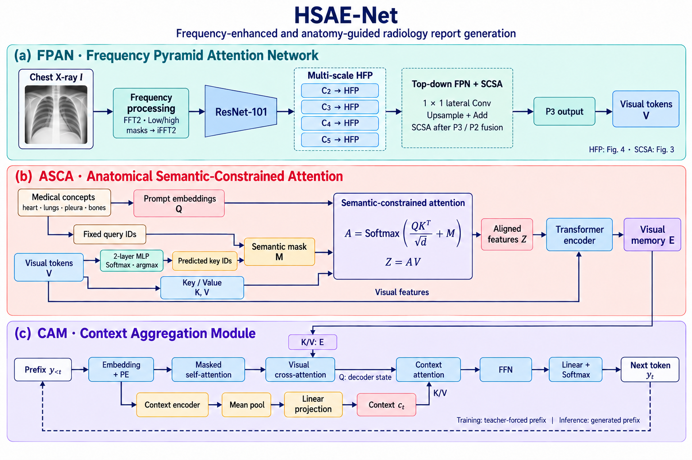
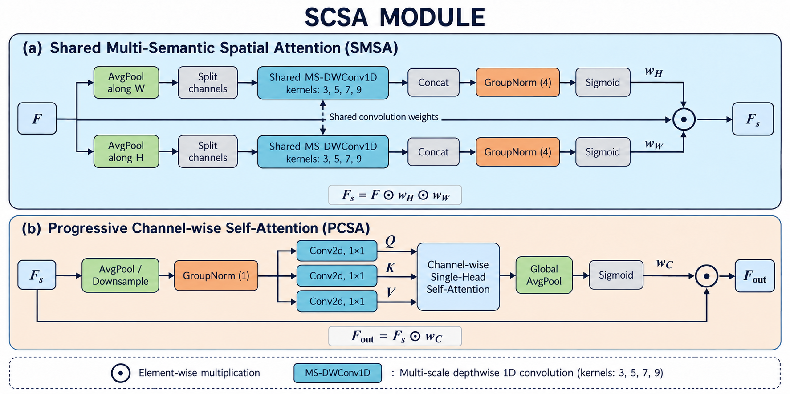
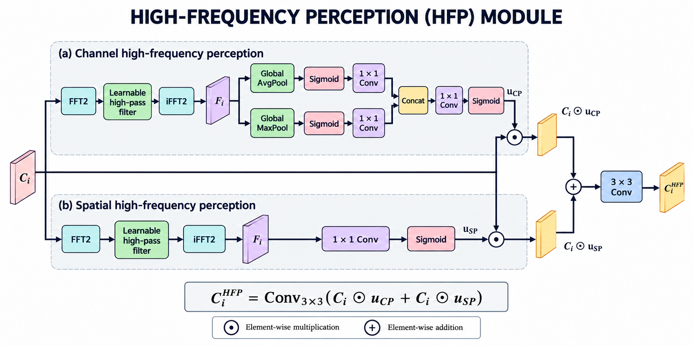

# HSAE-Net 论文方法图重绘

## 最新版：详细版 V2

根据反馈，V2 恢复了四尺度特征金字塔、频谱与掩码、张量堆叠、3/5/7/9 多尺度卷积、语义类别与注意力矩阵，以及上下文解码路径。V1 保留在下方供比较。

- [详细版 V2：查看三张图与说明](paper-figures/detailed-v2/README.md)
- [下载详细版 V2 PNG 合集](paper-figures/detailed-v2/HSAE_Net_Detailed_V2.zip)

打开 ZIP 文件页面后，点击 **Download raw file（下载原始文件）** 保存到本地。

### 图 2：HSAE-Net 详细架构

### 图 3：SCSA 详细结构

### 图 4：HFP 详细结构

图中频谱、权重与纹理均为结构示意。文稿中的部分图文差异及本次绘图选择详见 [V2 说明](paper-figures/detailed-v2/README.md)。

展开第一版 V1（简化版）及原核对记录

# HSAE-Net 论文方法图重绘

本分支交付论文中的图 2、图 3、图 4。图片保留英文术语，并统一配色、字体与连线。

## 下载

- [下载三张 PNG 与说明的 ZIP 压缩包](paper-figures/HSAE_Net_Figures_2-4.zip)
- [图 2：HSAE-Net 总体架构（1536 × 1024 PNG）](paper-figures/Fig2_HSAE_Net.png)
- [图 3：SCSA 模块（1774 × 887 PNG）](paper-figures/Fig3_SCSA.png)
- [图 4：HFP 模块（1774 × 887 PNG）](paper-figures/Fig4_HFP.png)

打开文件后，使用 GitHub 文件页面的下载原始文件按钮保存到本地。也可以通过本分支的 **Code → Download ZIP** 下载整个分支。

## 预览

### 图 2：HSAE-Net 总体架构

### 图 3：SCSA 模块

### 图 4：HFP 模块

## 重绘依据

参见[简要说明](paper-figures/重绘说明.txt)与[完整图文核对记录](paper-figures/绘图依据与图文差异.md)。

当前文稿中部分文字、公式和原图存在差异：总体架构按所列正文与公式统一；SCSA 方向分支沿用原图结构。这些选择尚未与模型实现代码核验。

