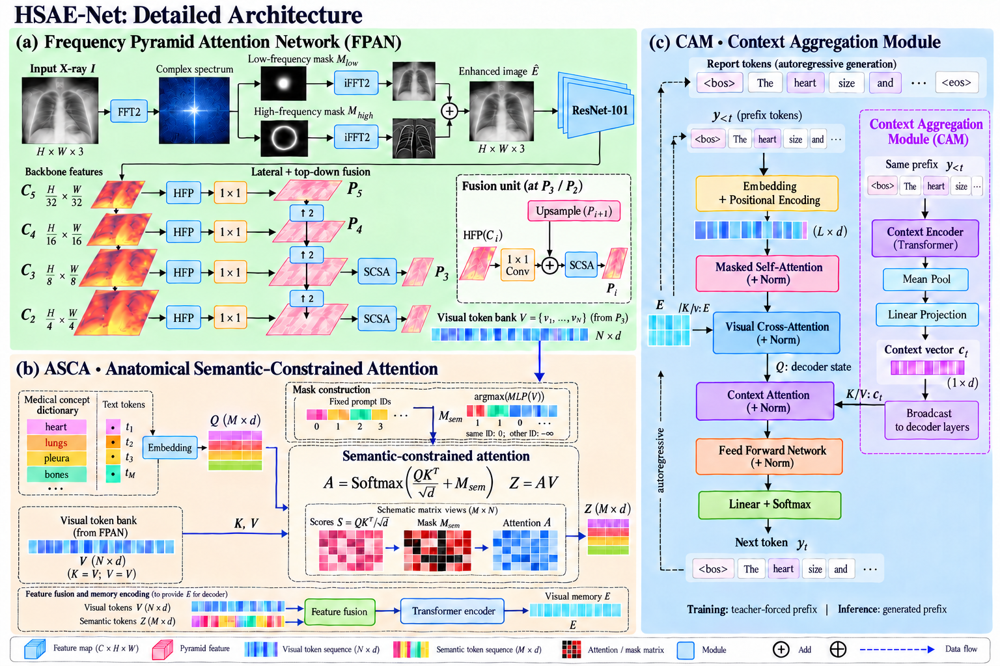
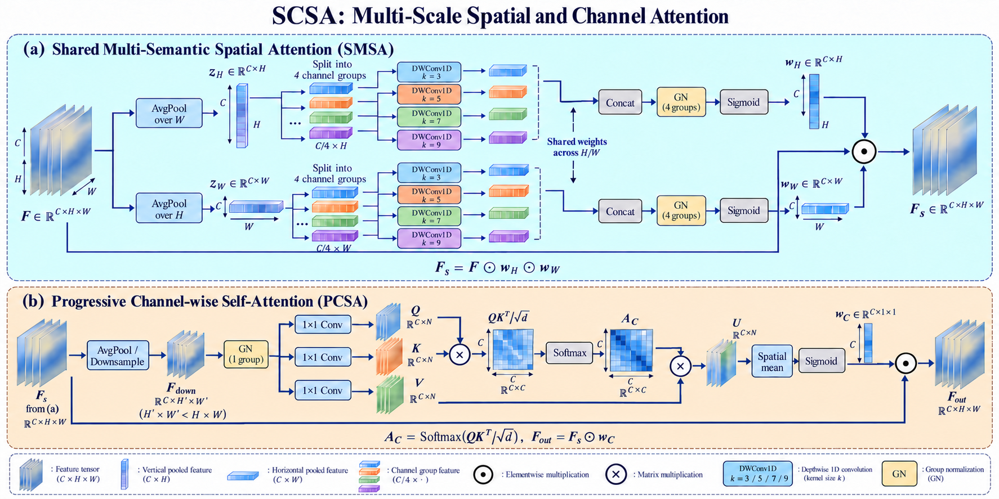
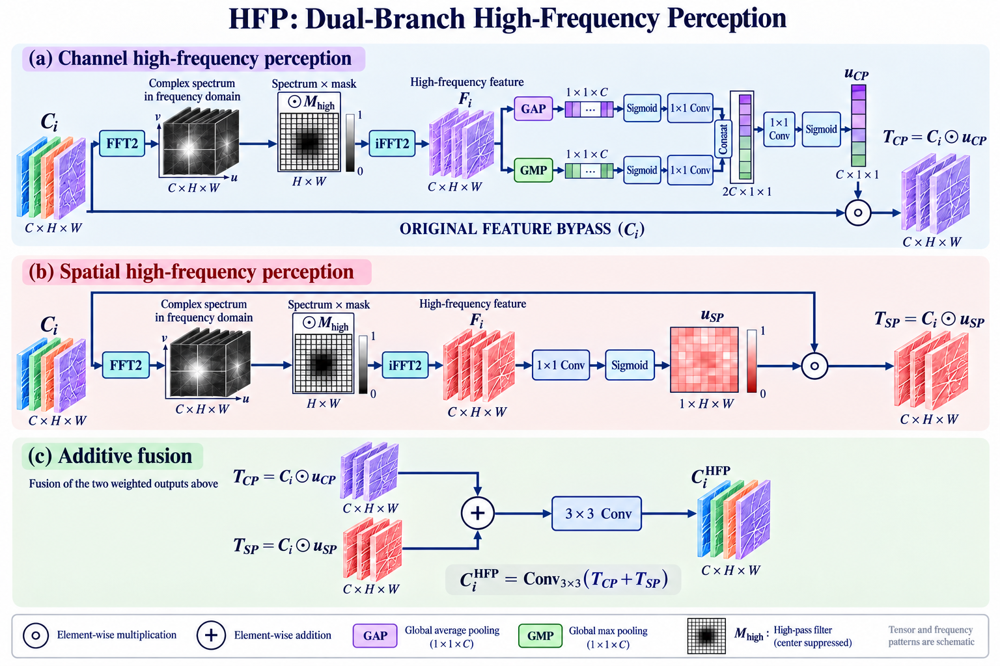

# HSAE-Net 论文方法图：详细版 V2

本版根据反馈恢复了原论文图的机制细节与图形层次，保留 V1 供比较。

## 下载和预览

- [下载详细版 V2 PNG 合集](HSAE_Net_Detailed_V2.zip)
- [图 2：HSAE-Net 详细架构](Fig2_HSAE_Net_Detailed_V2.png)
- [图 3：SCSA 详细结构](Fig3_SCSA_Detailed_V2.png)
- [图 4：HFP 详细结构](Fig4_HFP_Detailed_V2.png)

### 图 2

### 图 3

### 图 4

## 本版增加的内容

- **图2：总体架构。** 展开 FFT 频谱与高低频掩码、C2–C5 四尺度特征、HFP 横向连接、P5→P2 自顶向下金字塔、P3/P2 融合后的 SCSA、查询/键类别标签与语义掩码、注意力矩阵及 CAM 前缀上下文路径。
- **图3：SCSA。** 用特征张量与方向池化条带展示 H/W 路径，展开 3/5/7/9 多尺度深度卷积、四通道分组与共享权重，并展开 Q/K/V 通道注意力与加权过程。
- **图4：HFP。** 增加频谱、高通掩码、特征图堆叠、GAP/GMP 池化向量、通道权重、空间权重网格和最终双分支融合示意。

频谱、特征纹理、权重矩阵与张量颜色均为结构示意，不是模型实测可视化。图3通道注意力中的 N 表示下采样后的空间位置数（H′×W′）。

## 图文依据

沿用上一版的核对原则：图2频域位置与CAM顺序按正文/公式统一；图3方向分支按原图保留；图4使用FFT高频特征与C_i^HFP输出。原文尚存的图文差异参见[原稿图文核对记录](Content_Audit.md)。

图片以生成工具原生分辨率交付，未使用插值放大伪装分辨率。未将论文原始文档上传到仓库。
